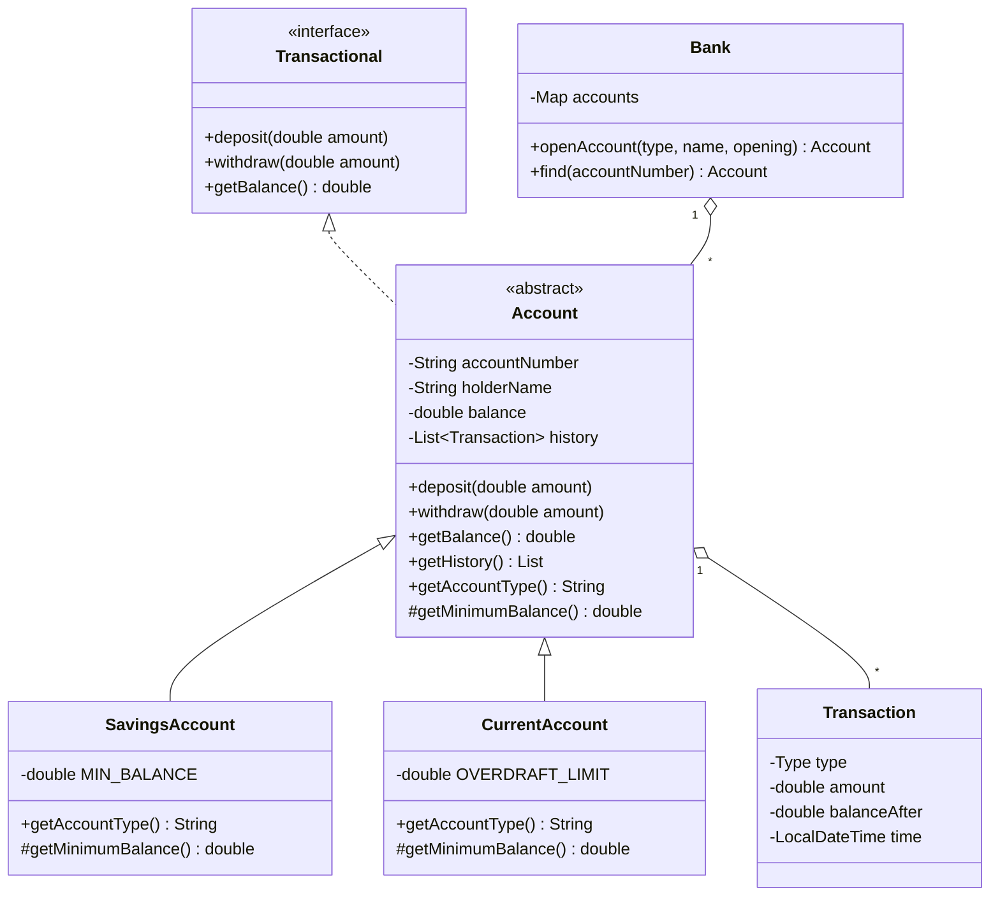

# Java Banking Management System

A console-based banking application built to practise Object-Oriented Programming in Java.

## Features
- Open Savings or Current accounts
- Deposit and withdraw money
- Check balance
- View transaction history (type, amount, balance after, timestamp)
- Input validation and custom exceptions

## How to run
```bash
javac BankingSystem.java
java BankingSystem
```

## OOP concepts used

| Concept | Where it appears |
|---|---|
| Classes and objects | `Account`, `Transaction`, `Bank` and their instances |
| Constructors | `Account(...)`, `SavingsAccount(...)` call `super(...)` and validate input |
| Encapsulation | Private fields in `Account`; history returned as an unmodifiable list |
| Inheritance | `SavingsAccount` and `CurrentAccount` extend `Account` |
| Abstraction | `Account` is abstract with abstract methods `getAccountType()` and `getMinimumBalance()` |
| Interface implementation | `Account implements Transactional` |
| Method overriding | Subclasses override `getAccountType()` and `getMinimumBalance()`; `toString()` is overridden |
| Polymorphism | `Bank` stores every account as an `Account`; `withdraw` behaves differently per account type |
| Access modifiers | `private` (data), `protected` (`getMinimumBalance`), `public` (API), package-private helper classes |

## Design

**Account rules**
- Savings: opening balance of at least 500, and the balance can never drop below 500.
- Current: an overdraft of up to 5000 is allowed.

**Class responsibilities**
- `Transactional` – contract for deposit, withdraw and balance.
- `Account` – shared logic: validation, balance updates, history.
- `SavingsAccount` / `CurrentAccount` – define the minimum balance rule.
- `Transaction` – immutable record of one deposit or withdrawal.
- `Bank` – creates accounts and looks them up by account number.
- `InsufficientFundsException` / `AccountNotFoundException` – clear error handling.
- `BankingSystem` – menu and user interaction.

## Class diagram



## Sample output
_Add a screenshot of the program running here._
